# Windows-Server-Lab

## Opis
Celem lab-u jest przedstawienie czynności jakie można wykonać w Active Directory oraz rozwiązanie realnych problemów jakie użytkownik może napotkać w codzienności.
Głównie wykorzystywałem ADUC, DNS, DHCP, GPO, NTFS/SMB oraz PowerShell.

## Środowisko
### Specyfikacja
Wykorzystałem do tego Windows Server 2022.
### Struktura Sieci
Sieć ustawiona na wewnętrzną
#### Domain Control
Adresacja IP: Static
IPv4: 10.10.10.10
Maska: /24
Gateway: 10.10.10.1
DNS: 10.10.10.10 lub loopback 127.0.0.1
#### Workstation
Adresacja IP: Static
IPv4: 10.10.10.20
Maska: /24
Gateway: 10.10.10.1
DNS: 10.10.10.10

## Przebieg Lab-u
### 1. Utworzenie jednoski organizacyjnej (OU).
Wewnątrz niej stworzyłem strukturę podfolderów oraz grup zabezpieczeń. Dzięki temu można łatwiej przyznawać uprawnienia do plików konkretnym grupom lub osobom.

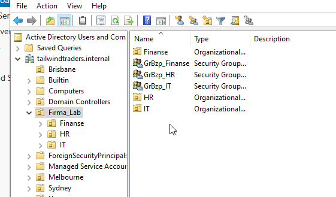

### 2. Automatyzacja tworzenia użytkowników (Powershell + CSV)
Aby usprwanić cały ten proces stworzyłem plik .csv który zawierał dane użytkownika (imię, nazwisko oraz dział)

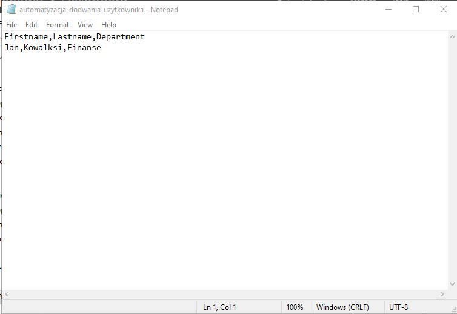

Po czym napisałem skrypt w PowerShell-u który odczytuje dane z pliku .csv i automatycznie generuje loginy, ustawia domyślne hasło (które należy zmienić przy pierwszym logowaniu) oraz przydziela użytkownika do odpowiedniej jednostki organizacyjnej.

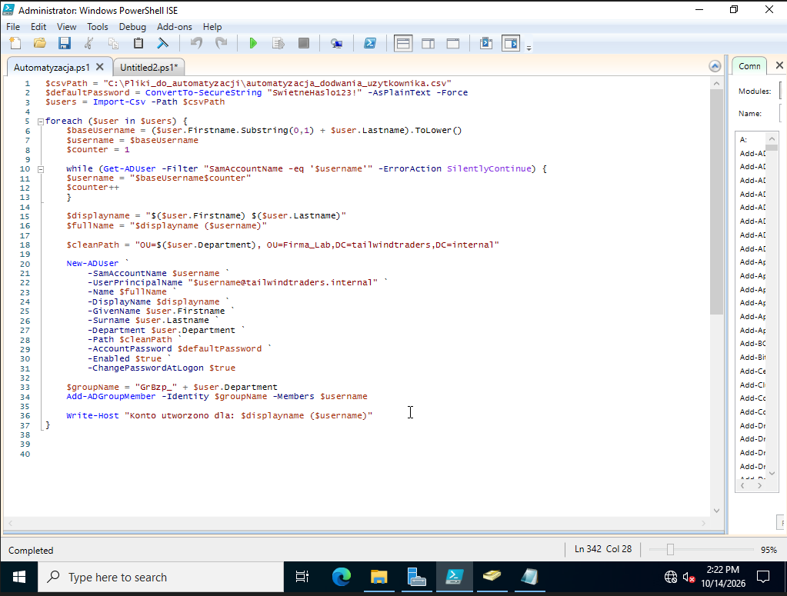

Ważnym elementem skryptu jest wykrywanie duplikacji. W przypadku gdy dwóch użytkowników ma ten sam login, skrypt wykrywa to i nadaje unikalny numer, przykładowo jkowalski1 oraz jkowalski2.

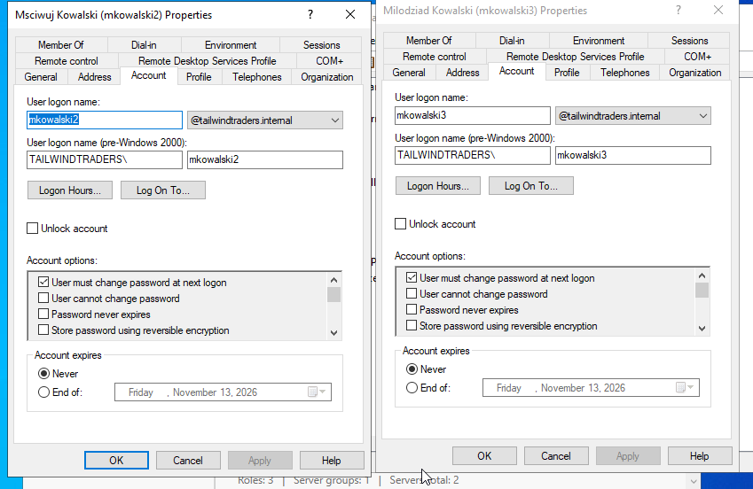

### 3. Wprowadzenie polityki bezpieczeństwa - GPO
W konsoli GPO utworzyłem nową politykę, której celem jest zabeczpieczenie komputerów przed użytkownikami. Zrobiłem to poprzez zablokowanie dostępu do panelu sterowania.
Politykę podpiełem pod jednostkę organizacyjną aby automatycznie objęła komputery i użytkowników w domenie.

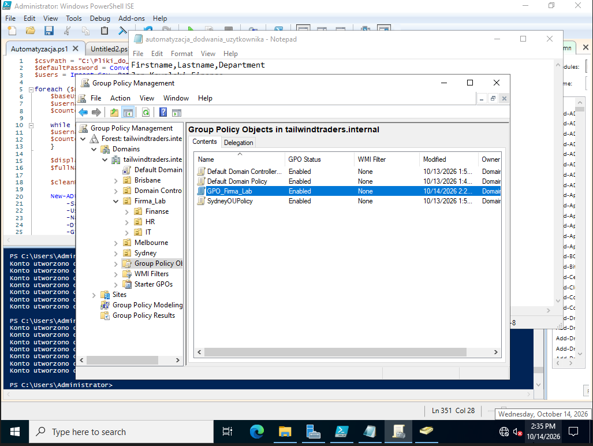

Następnie by sprawdzić czy zabezpieczenie działa poprawnie, zalogowałem się na konto użytkownika i spróbowałem wejść w panel sterowania (nie udanie)

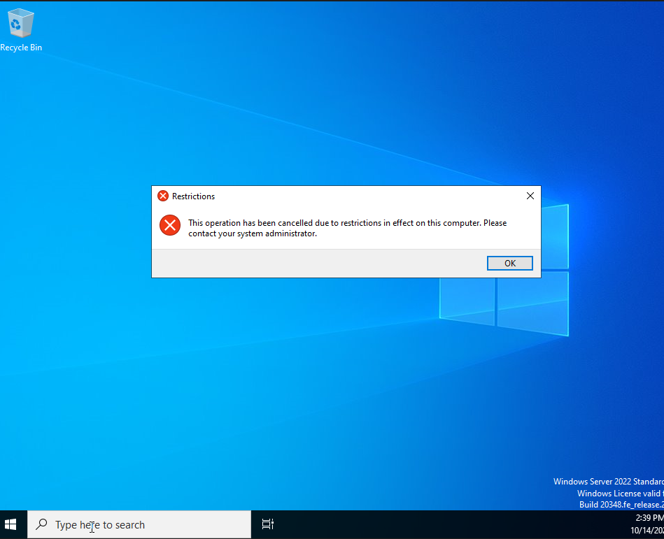

### 4. Utworzenie ogólnodostępnego folderu
Utowrzyłem folder sieciowy który służy jako ogólna przestrzeń robocza dla wszystkich użytkowników w sieci.

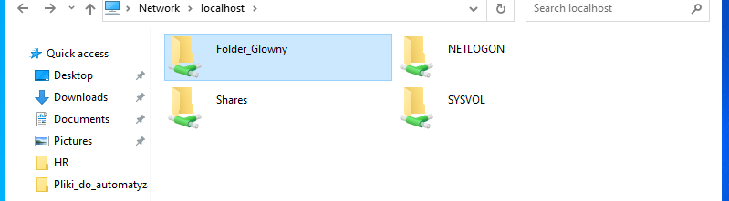

### 5. Konfiguracja Uprawnień (SMB + NTFS)
Stworzyłem dwa poziomy bezpieczeństwa dla plików, pierwszy - SMB, działa jak brama wjazdowa, udostępnia główny folder dla członów sieci w organizacji

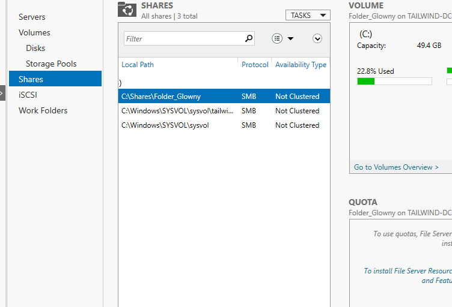

Następnie dodałem NTFS, działa jak zamki do konkretnych drzwi. Dzięki nim mogłem precyzyjnie dobrać kto ma dostęp do konkretnych podfolderów (Uprawnienia Read, Modify czy pełne Full Control).

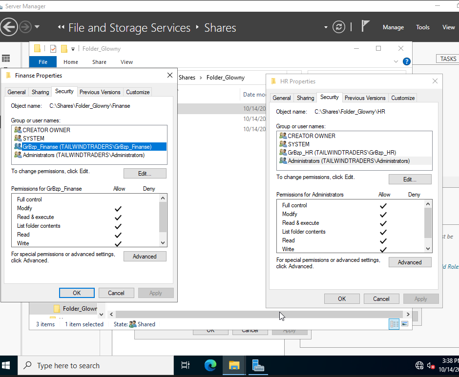

Dla testu wszedłem na konto użytkownika i sprawdziłem czy mogę wejść do podfolderów do których nie mam uprawnień

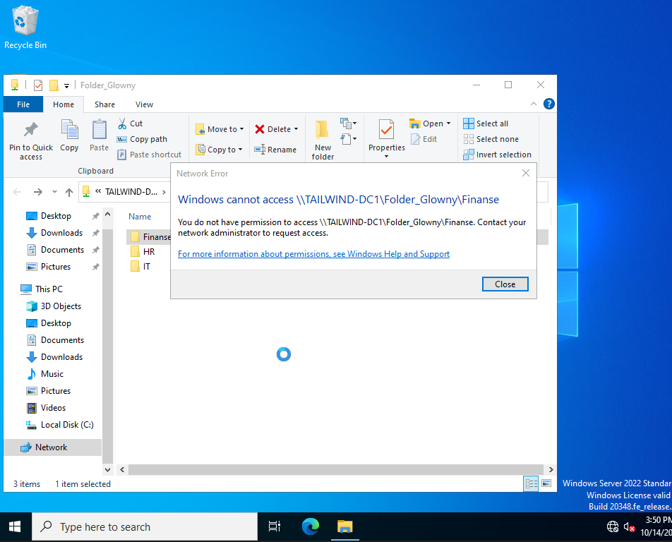

Wewnątrz głównego folderu warto uwzględnić że wyłączyłem dziedziczenie uprawnień aby ułatwić dobieranie konkretnych uprawnień.

### 6. Automatyczne mapowanie dysku dla użytkowników
Na koniec, dla ułatwienia żeby żaden użytkownik nie musiał wpisywać scieżki do dysku ręcznie utworzyłem nową politykę która automatycznie podpina dysk sieciowy pod litere Z: dając dostęp do jego folderów.

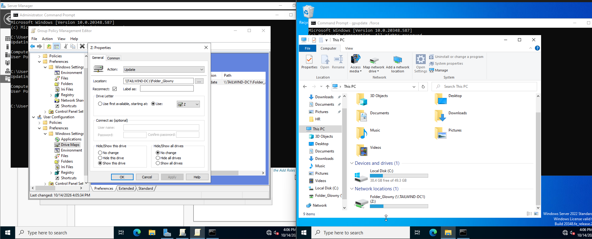

## Przykładowe problemy użytkowników i jak bym je rozwiązał

### 1. Brak Uprawnień
Pracownik zgłasza problem z brakiem możliwości otwarci pliku znajdującego się w folderze sieciowym. Pojawia się komunikat o brak uprawnień.

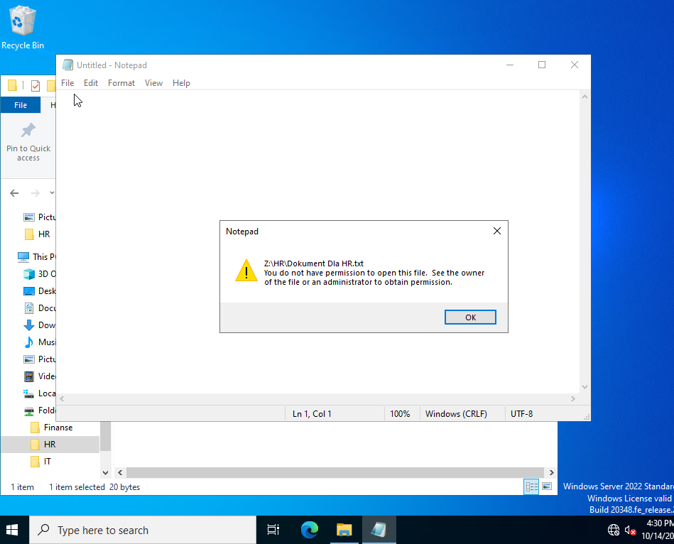

#### Diagnoza
By sprawdzić dlaczego tak jest sprawdzam ustawienia pliku. Properties -> Security -> Advanced. Sprawdzam konkretną grupę użytkownika czy powinna mieć do tego pliku dostęp lub ustawienia konkretnego użytkownika.

#### Rozwiązanie
W 'Active Directory Users and Computer' znajduję użytkownika i dodaje go odpowiedniej grupy, jeżeli natomiast uprawnienia tyczą się konkretnego użytkownika to zmieniam ustawienia uprawnień tak aby miał do pliku dostęp.

### 2. Brak połączenia z dyskiem sieciowym
Pracownik zgłasza problem z brakiem dostępu do dysku sieciowego Z:

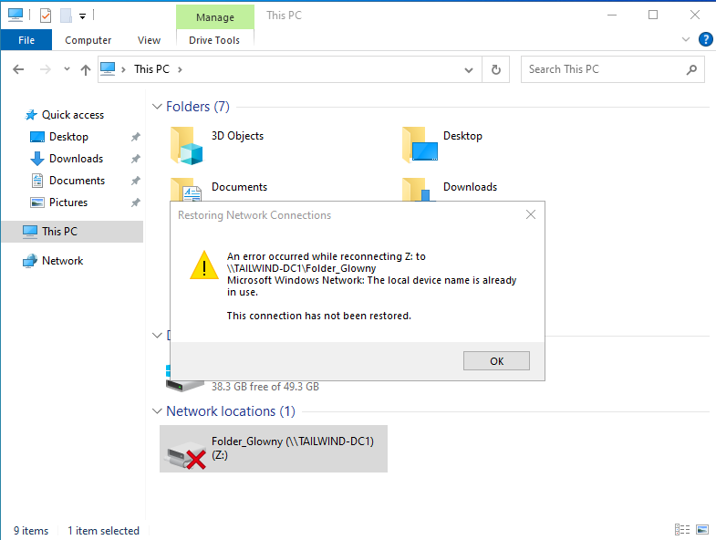

#### Diagnoza
Komputer stracił konktakt z Domain Control. By to sprawdzić pingował bym gateway czyli w tym przypadku 10.10.10.1. W przypadku informacji time request out, sprawdzam ustawienia karty sieciowej czy na pewno są dobrze ustawione.

#### Rozwiązanie
Otwieram ustawienia karty sieciowej na komputerze klienta. Zmieniam konfiguracje na prawidłowym - Jeżeli było włączone DHCP to zmienił bym na manulną oraz sprawdził ustawienia DNS czy na pewno wskazuje bezpośrednio na Domain Control. By sprawdzić czy rozwiązanie działa pinguje gateway.

### 3. Zapomniane Hasło
Pracownik zgłasza że nie może się zalogować - Nie pamięta hasła/Przekroczył ilość nieudanych prób logowania.

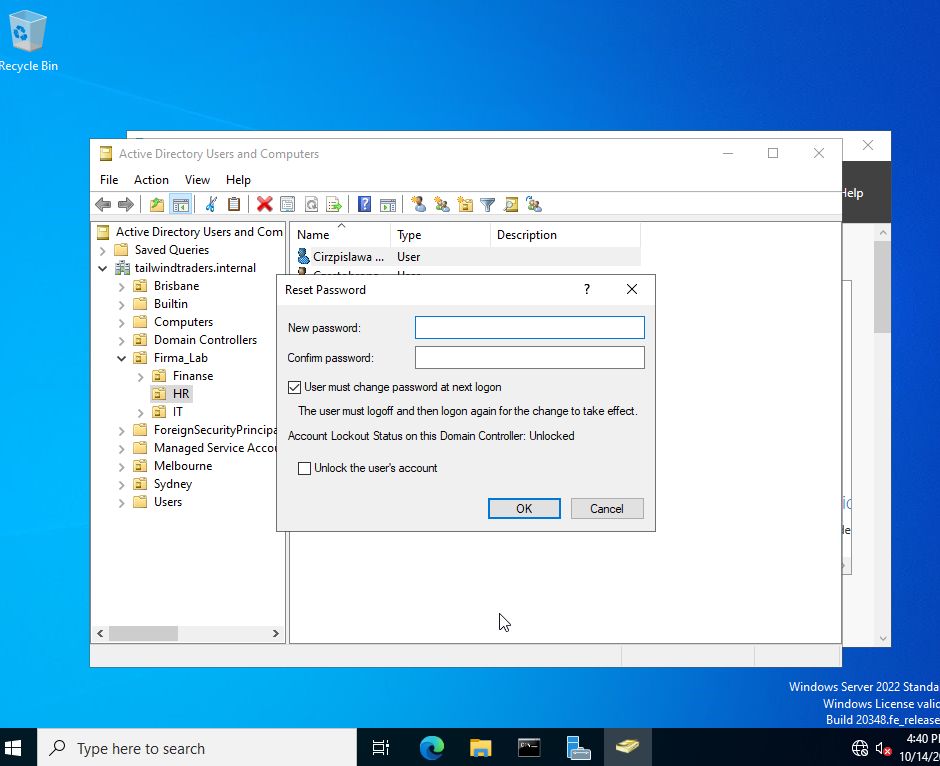

#### Rozwiązanie
Otwieram ADUC znajduję konkretnę konto użytkownika, wybieram opcje 'Reset Password...', tworze nowe tymczasowe haslo i zaznaczam aby użytkownik zmienił hasło przy następnym logowaniu.

